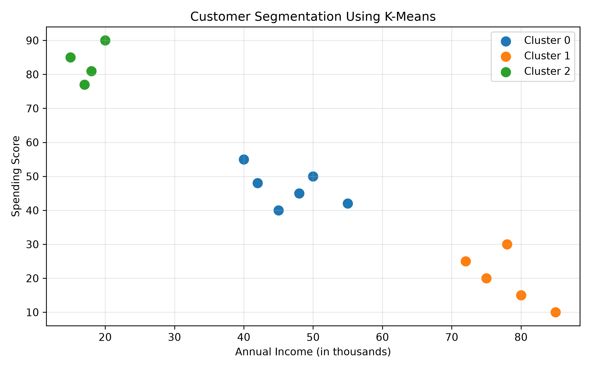

# Customer Segmentation Using Machine Learning

## Project Overview
This project uses Python and the K-Means clustering algorithm to group customers based on their annual income and spending score. The goal is to understand different customer groups and help businesses plan suitable marketing strategies.

## Objectives
- Analyze sample customer data.
- Group customers using K-Means clustering.
- Visualize customer groups using a scatter plot.
- Evaluate the clustering model using the Silhouette Score.
- Save customer group assignments in a CSV file.

## Technologies Used
- Python
- Pandas
- Matplotlib
- Scikit-learn
- NumPy

## Project Files
- `customer_segmentation.py` — Python source code.
- `customer_segments.png` — Customer segmentation graph.
- `customer_segments_results.csv` — Customer cluster assignments.
- `screenshots/` — Screenshots of the source code.

## Methodology
1. Create a sample customer dataset.
2. Select annual income and spending score as features.
3. Standardize the selected features.
4. Apply the K-Means clustering algorithm with three clusters.
5. Evaluate the clustering using the Silhouette Score.
6. Display and save the graph.
7. Export the results to a CSV file.

## Results
The model divides the sample customers into three groups. The scatter plot displays these groups according to annual income and spending score.

The program reported a Silhouette Score of 0.749 for this sample dataset. This indicates good separation among the clusters in this small illustrative dataset; it does not guarantee the same performance on real customer data.

## Graph

## Dataset Note
This project uses a small, illustrative sample dataset created in Python. It does not contain real customer information.

## Conclusion
This project demonstrates how machine learning can be used to identify customer groups from spending-related data. The results can help explain customer behavior and provide a starting point for more advanced customer analysis.